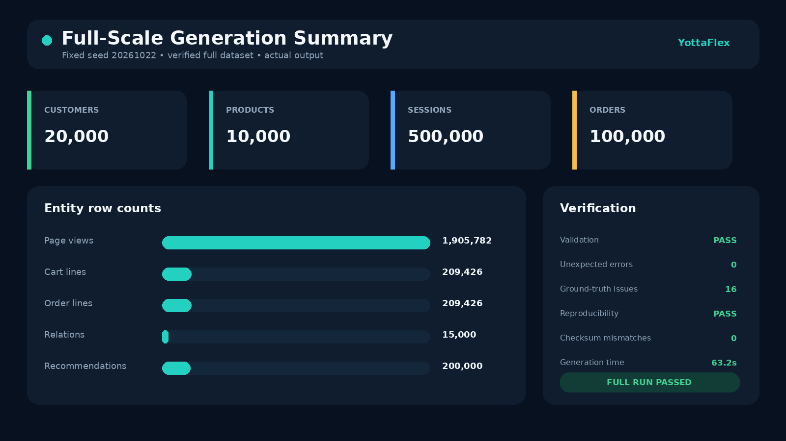
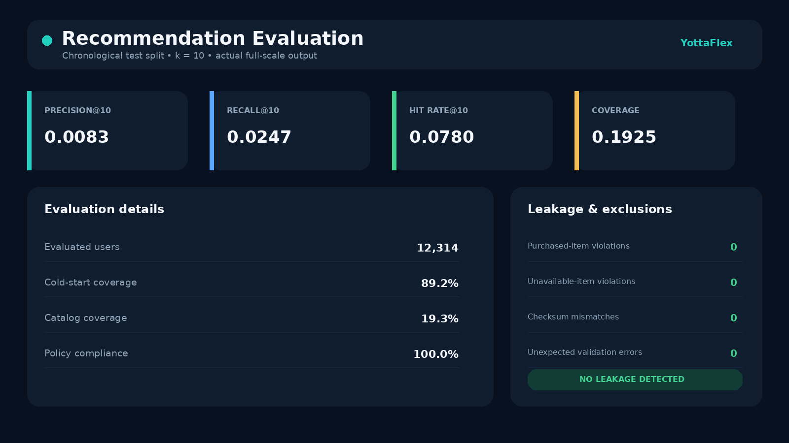

# Synthetic E-commerce Recommendation Data Pipeline

A deterministic, locally runnable Python project that generates related e-commerce master, event and transaction data; builds rule-based recommendations; injects labelled negative scenarios; and validates business and data-quality rules.

## What it produces

The generator creates 11 related entities: Customer, Product, Category, Session, PageView, Cart, CartLine, Order, OrderLine, ProductRelation and Recommendation. It exports CSV, JSONL and SQL seed data plus a separate ground-truth file, manifest, checksums and validation summary.

A verified starter CSV output is committed under `data/sample/`. Its validation status is PASS and it contains only synthetic data. Full-scale verification results are recorded in `docs/full_scale_verification.json`.

## Technology

- Python 3.10+ standard library for a portable first version
- `uv` for environment and command management
- Python unittest for automated tests
- CSV, JSONL and SQL output formats

No API key, external AI API, database server or internet connection is required.

## Quick start (Windows PowerShell)

```powershell
git clone https://github.com/TummalaNeeraj/yottaflex-ecommerce-recommender.git
cd yottaflex-ecommerce-recommender
uv venv
.venv\Scripts\activate
uv pip install -e .
python -m ecommerce_synth generate --config config/starter.json --output data/generated
python -m ecommerce_synth validate --input data/generated
python -m unittest discover -s tests -v
```

## Reproducibility check

```powershell
python -m ecommerce_synth reproduce --config config/starter.json --workdir data
```

The command generates the dataset twice with seed `20261022`, compares row counts and SHA-256 checksums, and writes `data/reproducibility_report.json`.

## Full-scale run

```powershell
python -m ecommerce_synth generate --config config/full.json --output data/generated
```

The full configuration requests 20,000 customers, 10,000 products, 500,000 sessions and 100,000 orders. Run the starter configuration first. Full CSV generation was verified successfully; exporting JSONL and SQL as well requires additional disk space.

For a faster full-scale verification that exports canonical CSV only:

```powershell
python -m ecommerce_synth generate --config config/full_csv.json --output data/full_verification
python -m ecommerce_synth reproduce --config config/full_csv.json --workdir data/full_repro
```

The full CSV run was executed successfully with seed `20261022`: 500,000 sessions, 100,000 orders, 1,905,782 page views and 200,000 recommendations. Validation and full-scale reproducibility both passed with zero checksum mismatches. CSV, JSONL and SQL remain available through `config/full.json`.

## Recommendation evaluation

`recommendation_metrics.json` evaluates cutoff-time recommendations against purchases after the chronological cutoff. It reports Precision@K, Recall@K, Hit Rate@K, catalog coverage, cold-start coverage and policy compliance. Training popularity, co-purchase relations and purchase exclusions use only pre-cutoff records.

The verified full-scale run produced 100% policy compliance with zero purchased-item or unavailable-item recommendation violations. Ranking metrics are intentionally modest because the generator includes sparse users, cold-start products and noisy/bot sessions rather than leaking future purchases into training.

To regenerate the README/report images from the verified metrics:

```powershell
uv run --extra reports python scripts/render_report_images.py
```





## Business flow

1. Generate Category, Customer and Product masters.
2. Generate Sessions and PageViews using valid parent IDs.
3. Create converted Carts, CartLines, Orders and OrderLines.
4. Derive order totals rather than generating totals independently.
5. Split sessions chronologically into train and test data.
6. Build co-purchase relationships and local rule-based recommendations using only pre-cutoff behaviour.
7. Exclude already-purchased, unavailable and discontinued items from baseline recommendations.
8. Inject the four required labelled negative scenarios.
9. Validate keys, joins, chronology, arithmetic and recommendation policies.
10. Export a manifest and compare fixed-seed checksums.

Detailed entity relationships, lifecycle handling and leakage controls are documented in `docs/architecture.md`. Field-level types, required/optional status, allowed values, units, uniqueness and validation rules are in `docs/data_dictionary.csv`.

## Output formats

Set `output_formats` in a config file to any supported combination containing CSV: `csv`, `jsonl`, and `sql`. CSV is canonical because validation reads it. `config/starter.json` and `config/full.json` export all three formats; `config/full_csv.json` is intended for fast full-scale verification.

## Required negative scenarios

- Purchase occurs before its originating session.
- Product category is missing.
- A post-cutoff test session is incorrectly labelled as training data.
- A recommendation contains a discontinued product.

These anomalies are intentional, isolated and recorded in `ground_truth.csv`. They are not silently corrected and ground truth is never used as an input feature.

## Repository notes

- Generated full datasets are ignored by Git to avoid repository size problems.
- Include small sample outputs or validation summaries when publishing.
- Never commit `.env`, API keys, recruitment emails, attached PDFs or confidential assessment wording.
- Before submission, open the public repository URL in a private browser window.

