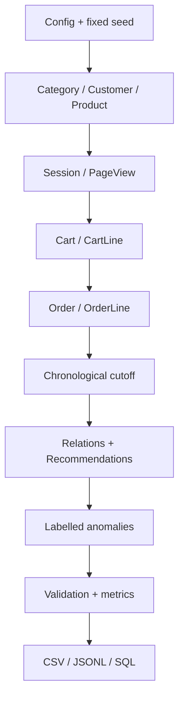
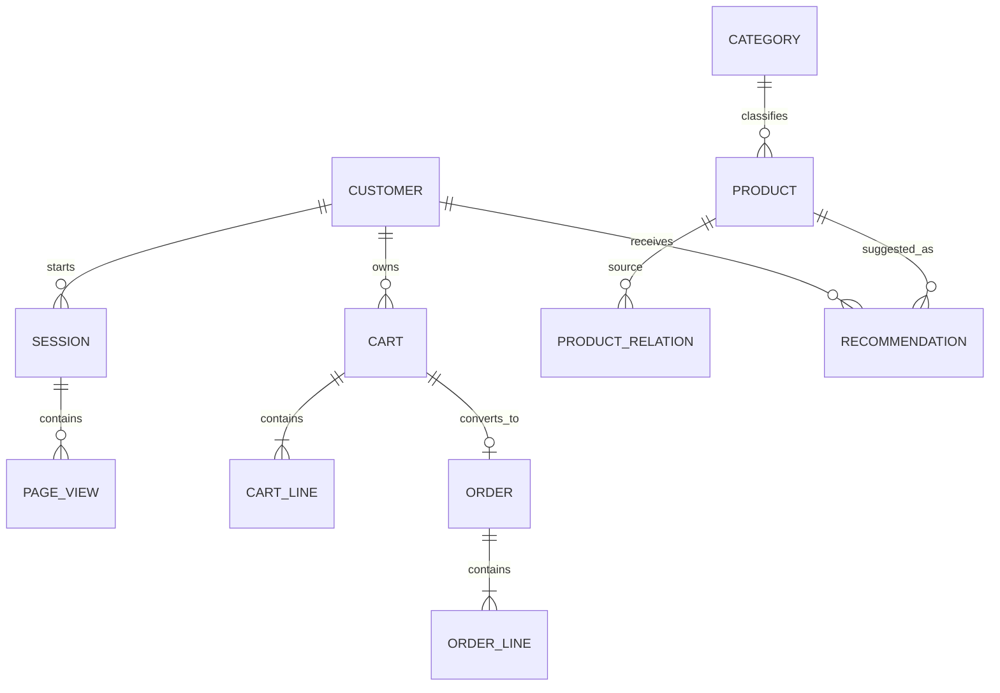

# Architecture and traceability

## Generation flow

Parent/master entities are always generated before dependent entities. Every child ID is chosen from the already-created parent collection. Transaction totals are calculated from line-level source values.

## Entity relationships

Optional relationships:

- Root categories have no parent category.
- A session can have no cart; the starter generation creates carts for converted sessions.
- A cart has an order only when it is converted.
- Effective end dates are blank for current Category, Product and ProductRelation records.

## Leakage prevention

The cutoff is 80% of the configured date interval.

- Sessions before the cutoff are training data.
- Sessions at or after the cutoff are test data.
- Preferred categories use only pre-cutoff page views.
- Popularity, co-purchase relationships and prior-purchase exclusions use only pre-cutoff orders.
- Post-cutoff purchases are used only as evaluation labels.
- `ground_truth.csv` is written after feature/recommendation generation and is never read by the recommender.

## Recommendation decisions

Candidates come from popular active products and products in the customer's most-viewed training categories. One low-ranked cold-start exploration item is included when `k >= 5`. Previously purchased, unavailable and discontinued products are excluded before ranking.

The baseline recommendation record preserves the rank, score, reason, generation time and model version. Required deliberate anomalies are injected afterward and remain traceable through `ground_truth.csv`.

## Lifecycle and history

- Entity identifiers are immutable.
- Category, Product and ProductRelation include effective dates instead of overwriting historical meaning.
- Session, Cart, Order and line records store their explicit lifecycle state.
- Page views and purchases are append-only events.
- Anomalies are labelled rather than repaired or hidden.

